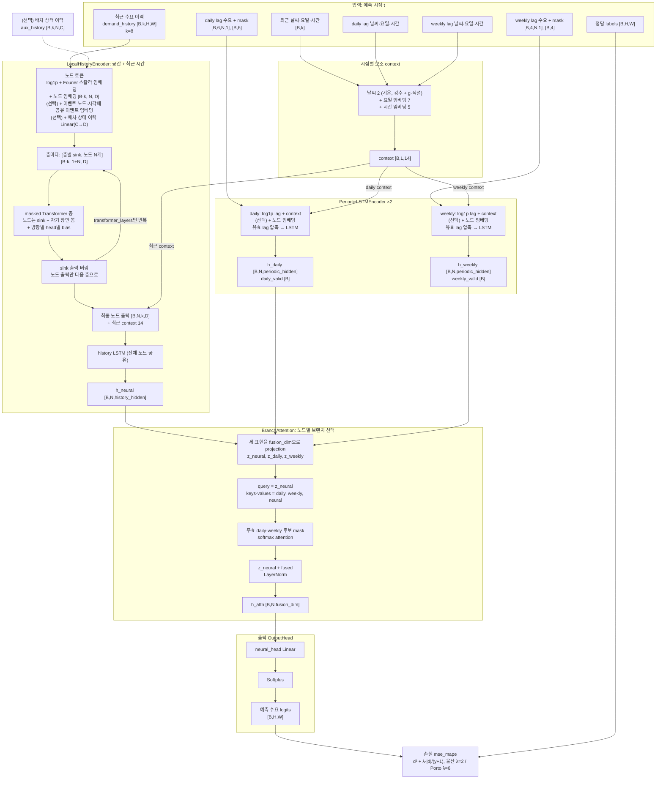

# merged 수요 예측 모델 SPEC

격자 단위 택시 수요를 1시간 앞으로 예측하는 `MergedDemandModel`과 그 학습·평가
파이프라인의 사양이다. **이 문서가 사양의 기준**이며, 사양 변경은 이 문서의 변경으로
추적한다. 코드 주석에는 변경 이력을 남기지 않는다.

각 절은 인터페이스(입출력·계약)를 먼저 적고, 구현 세부는 접힌 블록에 둔다.

## 목차

1. [데이터 흐름](#1-데이터-흐름)
2. [코드 지도](#2-코드-지도)
3. [데이터셋 `UnifiedDemandDataset`](#3-데이터셋-unifieddemanddataset)
4. [설정](#4-설정)
5. [모델 `MergedDemandModel`](#5-모델-mergeddemandmodel)
6. [모듈](#6-모듈)
7. [손실과 지표](#7-손실과-지표)
8. [학습 `train.py`](#8-학습-trainpy)
9. [평가·검증 도구](#9-평가검증-도구)
10. [실행 스크립트와 출력 경로](#10-실행-스크립트와-출력-경로)
11. [결과 보고 규약](#11-결과-보고-규약)

---

## 1. 데이터 흐름

점선은 선택 입력(`data.aux_grid`)일 때만 쓰인다.



기호: `B` batch, `k=time_step=8`(입력 시간 창), `N=H×W` 노드 수, `D=d_model`,
`P=(2a+1)²` 이웃 창 셀 수(`a=local_radius`; 3×3이면 9, 5×5이면 25),
`L`은 최근 이력 `k`, daily lag 6, weekly lag 4 중 하나.

---

## 2. 코드 지도

| 경로 | 역할 |
|---|---|
| `dataset_frame/unified_demand_dataset.py` | `UnifiedDemandDataset`: 시간 격자 → 학습 샘플 |
| `models/merged/config.py` | `MergedDemandConfig` (`PretrainedConfig`) |
| `models/merged/modeling.py` | `MergedDemandModel`: 조립, 데이터 흐름, 손실 |
| `models/merged/modules/history.py` | `LocalHistoryEncoder` |
| `models/merged/modules/embeddings.py` | `FourierScalarEmbedding` |
| `models/merged/modules/periodic.py` | `PeriodicLSTMEncoder` (+ 선택: 노드 임베딩) |
| `models/merged/modules/attention.py` | `BranchAttention` |
| `models/merged/modules/fusion.py` | `OutputHead` (출력 head) |
| `models/merged/losses.py`, `models/losses.py` | `build_loss`와 손실 구현 (`mse_mape`, `poisson` 등) |
| `models/merged/metrics.py`, `models/metrics.py` | `compute_merged_metrics`와 공용 지표 |
| `configs/config_{ulsan,porto}.yaml` | 도시별 Hydra 루트 설정 |
| `configs/model/merged_{ulsan,porto}.yaml` | 도시별 모델 하이퍼파라미터·스위치 |
| `configs/dataset/{ulsan,porto}.yaml` | 데이터 경로·분할 |
| `preprocessing/ulsan/build_dispatch_grid.py` | 원본 호출 기록 → 배차 상태 격자 `data/raw/ulsan_dispatch_grid.npy` (`data.aux_grid`) |
| `train.py` / `test.py` | 학습 / 체크포인트 평가 |
| `validate_merged.py` | 구조·인과 검증 |
| `visualize_merged_node_metrics.py` | 노드별 지표 지도 |
| `run_ablation.sh`, `run_seeds.sh` | 실험 러너 |

`dataset_frame/grid_demand_dataset.py`의 `GridDemandDataset`은 export만 되어 있고 이
파이프라인에서 쓰지 않는다.

---

## 3. 데이터셋 `UnifiedDemandDataset`

```python
UnifiedDemandDataset(
    data_path, split='train', *, weather_csv_path,
    time_step=24, daily_period=24, daily_lags=6,
    weekly_period=168, weekly_lags=4, lag_radius=0,
    train_ratio=0.70, val_ratio=0.15,
)
```

입력은 `[T,H,W]` 유한·비음수 수요 격자(`.npy`)와 행 수 `T`의 날씨 CSV다. 샘플 하나는
예측 시점 `t`(절대 시간 인덱스) 하나에 대응한다.

| 키 | shape / dtype | 의미 |
|---|---|---|
| `demand_history` | `[k,H,W]` float32 | 수요 `[t-k, t)` (raw) |
| `labels` | `[H,W]` float32 | 수요 `t` |
| `weather` | `[k,3]` float32 | 기온·강수·적설 CSV 행 `[t-k+1+ℓ, t+1+ℓ)` (예측 시점 날씨 포함, `ℓ = data.weather_lead`, 기본 0) |
| `hour_of_day`, `day_of_week` | `[k]` long | `[t-k, t)`의 시각(0–23)·요일(0–6) |
| `daily_demand` / `weekly_demand` | `[L,N,1]` float32 | lag 시점의 raw 수요 |
| `daily_mask` / `weekly_mask` | `[L]` bool | **True = 무효 lag** |
| `daily_weather`, `daily_hour`, `daily_day_of_week` | `[L,3]`, `[L]`, `[L]` | daily lag 시점 context |
| `weekly_weather`, `weekly_hour`, `weekly_day_of_week` | `[L,3]`, `[L]`, `[L]` | weekly lag 시점 context |

<details>
<summary>분할·lag·날씨 세부</summary>

- 분할 경계: `train_end = int(T·train_ratio)`, `val_end = int(T·(train_ratio+val_ratio))`.
  예측 시점은 train `[k, train_end)`, val `[max(k,train_end), val_end)`,
  test `[max(k,val_end), T)`. 샘플 `i`의 절대 시간 인덱스는 `dataset.indices[i]`다.
- lag: `period·i` (`i=1..count`)마다 `[-lag_radius, +lag_radius]` 오프셋을 펼치고
  양수만 남겨 **오래된 것부터** 정렬한다. `lag_radius=0`이면 정확한 배수만 쓴다.
  lag 원천 시점이 `<0`이면 수요·context를 0으로 채우고 mask를 True로 둔다.
- 날씨 CSV: cp949, 열 `기온(°C)`, `강수량(mm)`, `적설(cm)` 순서. 강수·적설 결측은 0으로
  채우고 기온 결측은 허용하지 않는다. 결과는 유한해야 한다.
- 기상청 ASOS 시간 자료의 강수는 정시 기준 **직전 1시간 누적**이고(행 `h` = `[h−1, h)`), 수요 격자의
  시각 `h`는 `[h, h+1)` 호출 수다. `ℓ=0`이면 최근 창 마지막 행이 `[t−1, t)` 강수라 예측 시각 `t`의
  강수를 보지 못한다. `data.weather_lead=1`이면 행을 한 칸 당겨 마지막 행이 `[t, t+1)` 강수(예보 가정)가
  된다. 마지막 시각 뒤는 마지막 행을 반복한다. lag 시점 날씨는 바꾸지 않는다. 값은 checkpoint config
  `weather_lead`에 저장되어 `test.py`가 따른다. 울산 3시드(채택 설정)에서 `ℓ=1`은 RMSE −0.10%,
  MAPE +0.28%로 차이 없음(기본 0 유지).
- 데이터셋은 정규화하지 않는다. 수요 `log1p`와 날씨 정규화는 모델이 한다.

</details>

---

## 4. 설정

Hydra 루트 설정은 도시별로 분리한다: `python train.py --config-name config_{ulsan,porto}`
(기본 `config_ulsan`). 루트는 `dataset: <city>`, `model: merged_<city>` 그룹을 포함한다.

### 4.1 `MergedDemandConfig`

데이터 파생 필드는 `train.py`가 train 구간에서 계산해 주입하고, 나머지는
`configs/model/merged_<city>.yaml`에서 온다.

| 그룹 | 필드 | 현재 값 (Ulsan / Porto) |
|---|---|---|
| 데이터 파생 | `height`, `width`, `time_step` | 14×12 / 10×20, 8 (`configs/dataset/<city>.yaml`) |
| | `temperature_min`, `temperature_max` | train 구간 기온 최솟값·최댓값 |
| | `precipitation_max` | train 구간 `강수 + 1·적설`의 최댓값 (> 0) |
| local | `local_radius` | 1 (3×3) |
| | `d_model` | 16 / 64 |
| | `num_fourier_bands` | 8 |
| | `transformer_layers`, `transformer_heads`, `transformer_ffn` | 2, 4, 128 |
| | `dropout`, `attention_dropout` | 0.10, 0.0 |
| | `history_hidden` | 64 |
| periodic | `periodic_hidden` | 64 |
| fusion | `fusion_dim` | 128 |
| context | `weekday_dim`, `hour_dim` | 7, 5 |
| 기능적 이웃 | `functional_neighbor_k`, `functional_neighbor_mode` | 0 (끔), `raw` — masked Transformer 수용 영역(`local_radius × transformer_layers`) 밖에서 train 구간 상관(`raw` 원 시계열 / `residual` 요일×시각 평균을 뺀 잔차)이 가장 큰 노드 k개를 train.py가 골라 `functional_neighbors`로 주입. 그 최근 수요 평균의 `Linear(1→D)(log1p)`를 노드 토큰에 더한다 |
| 추가 context | `context_extra_dim`, `context_features` | 0, [] — train.py가 `data.context_features`에서 주입. 채널은 날씨·요일·시간 뒤에 붙는다 |
| 이벤트 | `use_event_embedding`, `event_csv_path` | false, null — train.py가 `data.event_csv`가 있으면 켜고 절대경로를 저장. 공연·축제 등 모든 이벤트에 **같은** 학습 임베딩 `event_embedding [D]`(0 초기화)을 이벤트 시각·노드의 Transformer 입력 토큰에 더한다(§6.2) |
| 배차 상태 | `aux_channels`, `aux_grid_path` | 0, null — train.py가 `data.aux_grid`가 있으면 채널 수와 절대경로를 넣는다. 최근 창 `[t−k, t)`의 노드별 배차 상태 `log1p` 값을 `Linear(C→D)`로 Transformer 입력 토큰에 더한다(§6.2) |
| 주기 노드 임베딩 (선택) | `periodic_node_embedding_dim` | 0 (§6.3) |
| 손실 | `loss_type`, `mape_weight` | `mse_mape`, 울산 2.0 / Porto 6.0 |
| | `loss_gamma`, `loss_eps`, `rmse_weight`, `split_threshold`, `split_high_weight` | 1.0, 0.5, 10.0, 1.0, 1.0 |

### 4.2 기능 스위치

모든 스위치는 `model.<name>=...` Hydra 오버라이드로 바꾼다. 스위치는
**0-치환**이다: 모듈은 항상 생성·실행하고 결과 텐서만 0으로 바꿔 shape과 파라미터 수를
유지한다.

| 스위치 | 기본 | false일 때 |
|---|---|---|
| `use_daily` / `use_weekly` | true | `h_daily` / `h_weekly`를 0으로 (valid mask는 유지) |
| `use_weather` | true | 정규화 날씨를 0으로 (train 평균에 해당) |
| `use_calendar` | true | 요일·시간 임베딩을 0으로 |
| `use_neighbors` | true | masked attention에서 노드가 자기 자신과 sink만 보도록 이웃을 가림 |
| `use_sink` | true | 층별 sink 토큰을 쓰지 않음: 입력 `[B·k, N, D]`, mask `[N, N]`(노드는 자기 창만 봄), `sink_embedding` 없음. 채택 설정 5시드에서 끄면 울산은 차이 없음(RMSE +0.01%, MAPE −0.24%), Porto는 RMSE +1.69%(4/5)·MAE +0.50%(5/5)·MAPE −0.70%(5/5) |
| `local_encoder` | `masked_grid` | `crop`: 이전(커밋 `5cf69ed`) 방식. 노드마다 `(2a+1)²` 창을 잘라 `[CLS(+node_embedding), 창 값 토큰]` + 위치 임베딩을 독립 Transformer(마스크 없음)에 넣고 CLS 출력을 쓴다. 격자 밖은 EDGE 토큰. 이웃 토큰은 raw 값만 담는다(이웃의 문맥·정체성 없음). sink·방향 bias·이벤트·기능적 이웃·`cls_add` 날씨는 쓰지 않는다 (ablation 전용). 채택 설정 3시드: Porto RMSE crop 반경1 +2.4%·반경2 +5.3%(MAPE는 −1.8%·−0.7%), 차이는 대부분 이벤트 날 큰 수요 칸에서 나온다. 울산은 차이 없음 |
| `use_branch_attention` | true | 학습된 attention 대신 유효 브랜치 균등 평균 |
| `use_softplus` | true | neural head의 raw 선형 출력 사용 (음수 가능) |
| `weather_injection` | `concat` | `cls_add`: 날씨를 LSTM 입력 대신 Transformer 노드 토큰에 더함 |

루트 설정의 `ablation`은 결과 파일 이름·JSON 메타데이터용 라벨이며 모델을 바꾸지 않는다.
기본값은 `full`이다.

<details>
<summary>루트 설정 값 (두 도시 공통, 배치만 다름)</summary>

- `project_name=merged`, `seed=2026`, `device=cuda`.
- `dataset.train_ratio=0.70`, `dataset.val_ratio=0.15`.
- `data`: `daily_period=24`, `daily_lags=6`, `weekly_period=168`, `weekly_lags=4`,
  `lag_radius=0`, `context_features=[]`(선택: `holiday` 공휴일 0/1 — `configs/dataset/<city>.yaml`의
  `start_time`·`holidays` 필요, 울산은 2025-01-27 임시공휴일 포함 / `city_demand` 도시 전체 수요
  `log1p(합)/log1p(train 최댓값)`). 최근 창은 `[t−k, t)`, lag는 각 lag 시점 값이며 `context_extra`,
  `daily_context_extra`, `weekly_context_extra`로 모델에 들어간다.
- `data.event_csv` (기본 null, 선택): 이벤트 표 CSV(`node`, `start`, `end` 필수; `name`, `category`,
  `venue`, `precision`, `source`는 기록용). `start`·`end`는 `dataset.start_time`과 같은 현지 시각
  `YYYY-MM-DD HH:MM`. 시각 `h`의 `[h, h+1)`이 `[start, end)`와 겹치면 그 노드·시각을 1로 하는
  `[T, N]` 표를 만든다. 샘플은 `event_mask [k, N]`을 날씨와 같은 창 `[t−k+1, t+1)`로 받는다
  (일정은 미리 공개되므로 예측 시각 `t`를 포함). 울산 표는 `data/raw/ulsan_events.csv`: 2024-10~2025-03
  뉴스(Google News RSS 기사 LLM 추출)와 태화강 국가정원 공식 행사 캘린더에서 수요 반응이 확인된 5개
  카테고리(대형 축제·불꽃/낙화·지역 축제/마켓·빛축제/크리스마스·대중 콘서트)만, 격자 안 장소, 노드별 겹침 합침
  164구간(train 153 / val 5 / test 6). 채택 설정 3시드 결과: 전체 test 지표는 변화 없음(RMSE +0.05%,
  MAPE +0.44%), test 이벤트 셀 RMSE −7.6%(구간 중)·−5.4%(종료 직후).
- `data.aux_grid` (기본 null, 선택): 노드·시각별 배차 상태 `[T, H, W, C]` float `.npy`. 울산은
  `preprocessing/ulsan/build_dispatch_grid.py`가 원본 호출 기록(`raw/origin_data.csv`, 지역 필터만 적용, 중복 제거 전)에서
  만든다: `raw_calls`(전체 호출), `failed`(배차 실패, call_state=3), `wait_min`(성공 호출의 평균 대기 분),
  `high_send`(send_level≥3 호출). 수요 격자와 같은 좌표(700m, EPSG:5174)·시각(호출 시각 floor)이다.
  샘플은 `aux_history [k, N, C]`를 수요 이력과 같은 창 `[t−k, t)`로 받는다(예측 시각 이전에 관측된 값만).
  울산 채택 설정 3시드: test RMSE +0.06%, MAPE +0.02%(채택 대비) — 효과 없음. 채택 잔차와의 상관도 0.03~0.06.
- `train`: batch Ulsan 24 / Porto 8 (train·eval 동일), `num_train_epochs=120`,
  `optim=adamw_torch_fused`, `learning_rate=1e-3`, `weight_decay=0.05`, `max_grad_norm=5.0`,
  `lr_scheduler_type=constant`, `warmup_ratio=0`, epoch 단위 log/eval/save,
  `save_total_limit=1`, `load_best_model_at_end=true`, `metric_for_best_model=loss`,
  `greater_is_better=false`, `torch_compile=false`, `remove_unused_columns=false`,
  `full_determinism=false`.
- 처리량 설정(계산 결과 불변): `dataloader_num_workers=4`,
  `dataloader_persistent_workers=true`, `accelerator_config.non_blocking=true`(pinned memory
  비동기 복사), `logging_nan_inf_filter=false`(스텝별 NaN/Inf 검사 동기화 제거, 로그 집계에만
  영향), `save_only_model=true`(epoch 체크포인트에 optimizer·scheduler 미저장, 학습 재개 불가).
- `optimizer_schedule`: `warmup_cosine`, `warmup_epochs=5`, `warmup_lr_init=1e-6`,
  `cosine_epochs=60`, `eta_min=1e-4`.
- `callbacks.early_stopping`: `min_epochs=0`, `early_stopping_patience=20`.
- `description=???` (필수, 실험 설명), `limit_samples=null`, `run_json=null`.
- Hydra 실행 디렉터리 `output/${project_name}/${now:%Y-%m-%d}/${now:%H-%M-%S}`.

</details>

---

## 5. 모델 `MergedDemandModel`

`PreTrainedModel` 하위 클래스. 입력 이름은 데이터셋 키와 1:1이다.

```python
forward(demand_history, daily_demand, daily_mask, weekly_demand, weekly_mask,
        weather, hour_of_day, day_of_week,
        daily_weather, daily_hour, daily_day_of_week,
        weekly_weather, weekly_hour, weekly_day_of_week,
        labels=None, context_extra=None, daily_context_extra=None, weekly_context_extra=None,
        event_mask=None, aux_history=None) -> {'logits': [B,H,W], 'loss'?: scalar}
forward_debug(**batch) -> dict   # 분석·검증 전용
configure_loss(loss_type, *, rmse_weight=None, mape_weight=None) -> None
```

- `forward`는 HF `Trainer`용으로 `logits`와(라벨이 있으면) `loss`만 반환한다.
- `forward_debug`는 같은 계산의 전체 결과를 반환한다: `logits`, `prediction`,
  `prediction_flat`, `attention_weights`, `h_neural`, `h_attn`, `daily_valid`, `weekly_valid`,
  `loss`, `loss_sum`.
- `configure_loss`는 손실을 교체하고 `config.loss_type`(및 `rmse_weight`·`mape_weight`)을 함께 갱신해
  체크포인트가 학습 손실을 기록하게 한다.

<details>
<summary>조립·손실 집계·초기화 세부</summary>

- 생성 시 검증: `height,width,time_step>0`, `local_radius≥0`, `fusion_dim>0`,
  `d_model % transformer_heads == 0`, `weekday_dim,hour_dim>0`, `temperature_min/max`·
  `precipitation_max`가 있고 `temperature_max > temperature_min`, `precipitation_max > 0`,
  `weather_injection ∈ {concat, cls_add}`. 값 검사는 파이썬 값에서 한다(`from_pretrained`의
  meta device 초기화와 호환).
- 버퍼 `local_history.neighbor_direction`은 persistent로 체크포인트에 저장된다.
- 손실 집계: 요소별 손실(`combined`, `mae`, `demand_split`, `mse_mape`, `node_mix`, `poisson`)은 전체 원소
  평균을 `loss`로, 합을 `loss_sum`으로 낸다. `rmse_mape`는 손실 객체가 스칼라를 직접 반환한다.
- `_init_weights`는 아무것도 하지 않는다: PyTorch 기본 초기화를 유지하고 HF 기본 재초기화(std 0.02)를
  적용하지 않는다.

</details>

---

## 6. 모듈

### 6.1 보조 context (`MergedDemandModel._temporal_extra`)

`(weather [B,L,3], hour [B,L], day_of_week [B,L]) → extra [B,L,E]`

- 날씨 2채널 (`[B,L,2]`):
  - `temperature_norm = (기온 − temperature_min) / (temperature_max − temperature_min)`
  - `precipitation_norm = (강수 + g·적설) / precipitation_max`
  - `g`(`snow_scale`)는 1로 초기화되는 학습 스칼라다. `precipitation_max`는 `g=1` 기준
    train 최댓값으로 고정한다(g가 학습 중 바뀌므로 다시 재지 않는다).
  - clip하지 않으므로 val·test에서 train 범위를 벗어난 값은 [0,1] 밖일 수 있다.
- `concat`: `E = 2 + weekday_dim + hour_dim = 14` = 날씨 2 ⊕ 요일 임베딩 ⊕ 시간 임베딩.
  최근 이력·daily·weekly context 모두 같은 방식이다.
- `cls_add`: `E = weekday_dim + hour_dim = 12`. 날씨 2채널은 별도로
  `LocalHistoryEncoder`의 노드 토큰에 더해지며 주기 브랜치에는 날씨가 들어가지 않는다.
- 요일·시간 임베딩 테이블(`nn.Embedding(7,·)`, `nn.Embedding(24,·)`)은 세 브랜치가 공유한다.

### 6.2 `LocalHistoryEncoder`

`forward(demands [B,k,H,W], extra [B,k,E], weather_cls [B,k,2]|None, event_mask [B,k,N]|None) → h_neural [B,N,history_hidden]`

시점마다 격자 전체를 한 시퀀스로 인코딩한다. 노드 토큰은 시점당 한 번만 만들고, 이웃 창은
attention mask로 표현한다.

<details>
<summary>세부</summary>

1. 노드 토큰: `log1p(max(x,0))` → `FourierScalarEmbedding` → `+ node_embedding[n]`
   → `[B·k, N, D]` (`cls_add`면 `Linear(2→D)(날씨 2채널)`을 모든 노드 토큰에 더함).
   `use_event_embedding`이면 `event_mask[b,i,n]·event_embedding`을 더한다(모든 이벤트 공유 벡터).
   `FourierScalarEmbedding(v) = Linear([v, sin(2π·v·f), cos(2π·v·f)])`,
   `f = exp(log_frequencies)`, `log_frequencies`는 `linspace(-2,2,num_bands)`로 초기화되는
   학습 파라미터.
2. 층 `l`마다 입력 `[sink_l, 노드 N개]` (`[B·k, 1+N, D]`). `sink_embedding [layers, D]`는
   층별 독립 파라미터이며, 층 출력에서 sink는 버리고 노드 출력만 다음 층 입력이 된다.
3. attention mask `[B·k·heads, 1+N, 1+N]` (더하는 값):
   - sink 행·열은 가리지 않는다(0).
   - 노드 `i`→노드 `j`: `j`가 `i`의 `(2a+1)×(2a+1)` 창 안이면 `direction_bias[h, dir(i,j)]`,
     밖이면 `-inf`. `dir = (dy+a)·(2a+1) + (dx+a)`(행 우선, 자기 자신 `P//2`)이고
     `neighbor_direction [N,N]` 버퍼(창 밖 -1)에 저장한다. `direction_bias [heads, P]`는
     0으로 초기화되는 학습 파라미터다.
   - 격자 밖 이웃은 토큰이 없으므로 가장자리 노드는 창 안 실재 노드만 본다.
   - `use_neighbors=false`면 노드는 자기 자신과 sink만 본다.
   - `use_sink=false`면 sink를 붙이지 않고 노드 `N`개만 넣는다. mask는 노드 쌍 부분만 쓴다
     (모든 노드는 자기 자신을 보므로 전부 `-inf`인 행은 없다).
   - `global_nodes`(기본 빈 목록)에 든 노드 `g`는 **모든 노드가 볼 수 있다**(열 `g`를 가리지 않음).
     창 밖 쌍 `(i, g)`의 bias는 0으로 초기화되는 학습 파라미터 `global_bias [heads]`다(창 안이면
     `direction_bias` 그대로). `g` 자신이 보는 범위(행)는 바뀌지 않는다. 수요가 큰 노드의 상태가 도시 전체에
     영향을 주는지 보는 실험용이다. 채택 설정에서 수요 상위 20% 노드 하나씩(1시드, val로 선별 → 3시드):
     울산은 효과 없음(노드 55·62, 3시드 RMSE +0.04~0.08%·MAPE +0.11~0.30%), Porto는 선별한 4개 모두 RMSE −0.4~−0.8%·
     MAPE −0.4~−1.2%(노드 114는 3/3 시드 모두 개선). Porto는 40개 중 36개가 1시드 test MAPE를 낮춰 노드 고유 효과보다
     "전역 열 하나를 여는 것" 자체의 효과로 보인다.
4. 각 층은 pre-norm `nn.TransformerEncoderLayer`(GELU)이며 attention 가중치 dropout은
   `attention_dropout`, 나머지는 `dropout`. eval·no_grad의 MHA fast path는 3D float mask를
   올바르게 적용하지 않으므로 호출 동안 끈다.
5. 수용 영역은 층마다 넓어진다: `L`층 뒤 노드 출력은 반경 `a·L` 창의 정보를 가진다.
6. 최종 노드 출력 `[B·N, k, D]`에 `extra`를 브로드캐스트해 붙이고 공유
   `history_lstm (D+E → history_hidden)`의 마지막 hidden을 `h_neural`로 쓴다.

</details>

### 6.3 `PeriodicLSTMEncoder` (daily, weekly 각각)

`forward(values [B,L,N,1], invalid_mask [B,L], extra [B,L,E]) → (h [B,N,periodic_hidden], valid [B])`

- `valid[b]` = 유효 lag가 하나 이상인지.
- `periodic_node_embedding_dim = d > 0` (선택, 기본 0): 학습 노드 임베딩 `[N, d]`(N(0, 0.1²) 초기화)를 모든 lag 입력에
  붙인다(`1+E → 1+E+d`). 공용 주기 LSTM이 노드 정체성을 본다(노드별 게이트 bias `W_e·e_n`와 같은 효과).

<details>
<summary>세부</summary>

- 입력 `log1p(max(x,0)) ⊕ extra`를 노드별 시퀀스 `[B·N, L, 1+E]`로 만든다.
- 무효 lag를 뒤로 보내도록 안정 정렬해 유효 lag만 원래 순서대로 앞에 모은 뒤, LSTM
  (`1+E → periodic_hidden`)을 전체 길이로 돌리고 각 행의 마지막 유효 시점(`길이−1`) 출력을
  쓴다. 이는 유효 lag만 넣은 LSTM의 마지막 hidden과 같다. bool index·packing을 쓰지 않아
  GPU→CPU 동기화가 없다.
- 유효 lag가 없는 행의 출력은 0이다(곱셈으로 0을 만들어 gradient도 0).

</details>

### 6.4 `BranchAttention`

`forward(h_neural, h_daily, h_weekly, daily_valid, weekly_valid) → (h_attn [B,N,fusion_dim], weights [B,N,3])`

- 후보 순서는 `[daily, weekly, neural]`. neural 후보는 항상 유효하므로 주기 lag가 전부
  무효여도 출력이 정의된다.

<details>
<summary>세부</summary>

- `z_* = Linear(h_*) → fusion_dim`. query는 `W_q z_neural`, key·value는 세 후보의
  `W_k z`, `W_v z`(bias 없음).
- score `= q·k / √fusion_dim`, 무효 후보는 dtype 최솟값으로 마스킹 후 softmax.
  `use_branch_attention=false`면 유효 후보 균등 가중.
- `h_attn = LayerNorm(z_neural + Linear(Σ w·v))`.

</details>

### 6.5 출력 `OutputHead`

`forward(h_attn [B,N,fusion_dim]) → prediction [B,N]`

- `prediction = Softplus(neural_head(h_attn))` (`use_softplus=false`면 raw). `neural_head`는 `Linear(fusion_dim→1)`.
- `prediction`을 `[B,H,W]`로 reshape한 것이 `logits`다.

> 노드별 가중치 적응(ΔW, gated·basis·MoE 변형 포함, 2-stage 학습)과 인과 검색기(`CausalRetrieval`·검색 gate)는
> 커밋 `eb92db5`까지 있었고 제거했다. ΔW는 파라미터가 공유 모델의 약 14~35배(울산 594만 / 17만)인데 울산 효과는
> RMSE·MAPE 0.1~0.3% 수준이었고, 검색기는 채택 설정에서 쓰지 않았다. 실험 기록은 Notion 기록 페이지에 있다.

---

## 7. 손실과 지표

`build_loss(loss_type, ...)`. `rmse_mape`만 스칼라(`SCALAR_LOSS_TYPES`)이고 나머지는
요소별(`reduction='none'`)이다. `d = y_pred − y_true`.

| `loss_type` | 정의 |
|---|---|
| `mae` (기본) | `|d|` |
| `combined` | `d² + γ·(d/(y_true+ε))²` (`γ=loss_gamma`, `ε=loss_eps`) |
| `rmse_mape` | `rmse_weight·RMSE + MAPE(+1)` |
| `demand_split` | `y ≤ split_threshold`: `|d|/(|y|+1)`, 그 외: `split_high_weight·d²` |
| `mse_mape` | `d² + mape_weight·|d|/(|y|+1)` (제곱항은 평균 쪽, 상대항은 저수요 칸을 0 쪽으로) |
| `node_mix` | 노드 `n`마다 `r_n·[λ_n·|d|/((|y|+1)·B_n) + (1−λ_n)·d²/(2A_n)]` (아래) |
| `poisson` | `ŷ − y·ln(ŷ + 1e−6)` (Poisson NLL). 출력 `ŷ`는 평균 수요 μ다(점 예측 = μ) |

**`poisson` 실험 (울산, 3시드, 당시 2-stage 학습)** — 표현은 likelihood로 배우고 점 예측은 평가 목적으로 따로 정할 수 있는지 확인했다.

- μ 그대로: test RMSE −5.39% / MAPE +32.9% (ADFormer 8h 대비). μ의 test MSE(0.477)가 평균 μ(0.481)와 같아
  잔차가 Poisson 잡음 수준이다.
- 오프라인 결정 `c* = argmin_c E[(Y − c)²] + λ·E[|Y − c|/(Y + 1)]` (`Y ~ Poisson(μ)`, 또는 val에서 μ 구간별로 실측 분포로
  최적화): λ=2.25에서 −2.44% / −2.43%로 mse_mape λ=2 학습(−2.45% / −2.42%)과 같은 RMSE↔MAPE 교환선. NB(분산 1.2μ·1.5μ)도 같은 선.
- μ를 진짜라 놓고 Poisson으로 표본을 뽑아 같은 결정을 하면 −2.26% / −2.26% → 이 데이터의 잡음만으로 교환선이 정해진다.
  결정 규칙은 코드에 넣지 않았다(`/tmp` 분석).

**`node_mix`** — 노드 수요 수준에 따라 MAPE·MSE 비중을 바꾸되, 노드 사이 업데이트 비중은 바꾸지 않는다.

- `μ_n`: train 구간 노드 평균 수요. `λ_n = λ_hi + (λ_lo − λ_hi)·σ((ln τ − ln(μ_n + 0.01)) / w)`
  (`node_mix_lambda_low`, `node_mix_lambda_high`, `node_mix_tau`, `node_mix_width`). 저수요 노드는 `λ_lo`(MAPE 쪽),
  고수요 노드는 `λ_hi`(MSE 쪽).
- 두 항의 기울기 크기를 노드 안에서 맞춘다. `ŷ_ref`는 train 구간 노드×요일×시각 평균(기준 예측).
  - MAPE 항 `|d|/(|y|+1)`의 기울기 크기는 `1/(y+1)`이므로 `B_n = mean_train 1/(y+1)`로 나눈다.
  - MSE 항 `d²`의 기울기 크기는 `2|d|`이므로 `A_n = max(mean_train |y − ŷ_ref|, 0.05)`일 때 `2A_n`으로 나눈다.
  - 그러면 기준 잔차에서 두 항의 기대 기울기 크기가 모두 1이 되어 `λ_n`은 노드 안에서 손실의 **모양**만 정한다.
- 노드 scaler `r_n = λ̄·B_n + (1 − λ̄)·2A_n`, `λ̄`=`λ_n`의 노드 평균. 기준 잔차에서 노드 `n`의 기대 기울기 크기가
  `r_n`으로 고정되며, 이는 모든 노드에 같은 `λ̄`를 쓴 `λ̄·|d|/(|y|+1) + (1−λ̄)·d²`의 노드별 기울기 크기와 같다.
  즉 `λ_n`을 노드마다 바꿔도 노드 사이 업데이트 비중은 균일 `λ̄` 손실과 같다. `node_mix_scaler=false`면
  `r_n=1`, 정규화 없이 `λ_n·|d|/(|y|+1) + (1−λ_n)·d²`(대조군).
- `λ_n`, `1/B_n`, `1/(2A_n)`, `r_n`은 train.py가 train 구간에서 계산해 config(`node_mix_lambda`,
  `node_mix_mape_scale`, `node_mix_mse_scale`, `node_mix_weight`, 길이 N)에 넣는다. 손실 텐서는 비영속 버퍼다.
- 울산 3시드(당시 2-stage 학습, ADF 8h 대비 RMSE / MAPE): (λ_lo, λ_hi) = (0.9, 0.1) −3.70% / +4.62%, (0.95, 0.2)
  −3.03% / +0.65%, (0.97, 0.35) −2.02% / −3.62%, (0.98, 0.5) −0.21% / −7.59%. 같은 MAPE에서 `mse_mape` 경계보다
  RMSE가 약 0.1%p 낫거나 같아(시드 편차 수준) 채택하지 않았다. scaler를 끄면((0.9, 0.1)) −3.94% / +8.72%.

`compute_merged_metrics(preds, labels)`:

| 지표 | 정의 |
|---|---|
| `rmse` | `√mean(d²)` |
| `mae` | `mean(|d|)` |
| `mape_plus1` | `mean(|d|/(|y|+1))·100` |
| `mape_excl_zero` | `y≠0` 셀에서 `mean(|d|/|y|)·100` (없으면 NaN) |

---

## 8. 학습 `train.py`

```bash
python train.py --config-name config_<city> "description='실험 설명'" \
  [seed=...] [model.<key>=...] [hydra.run.dir=...] [run_json=...]
```

- `description`은 필수다. 값에 공백·쉼표·괄호가 있으면 위처럼 작은따옴표로 감싼다.
- 실험은 변경 사항을 **커밋한 뒤** 실행한다. 로그 맨 위 두 줄은 다음과 같고, 커밋되지 않은
  추적 파일 변경이 있으면 해시 뒤에 `(dirty)`가 붙는다.

  ```text
  [Description] <description>
  [Commit] <HEAD 해시>[ (dirty)]
  ```

1. 세 split의 `UnifiedDemandDataset`을 만든다.
2. train 구간에서 날씨 통계(`node_mix`면 노드별 손실 벡터, `functional_neighbor_k>0`이면 기능적 이웃도)를 계산해
   `MergedDemandConfig`에 주입하고, seed 고정 후 모델을 만든다.
3. 한 번의 Trainer로 학습한다(`train.learning_rate`, `model.loss_type`). 검증 `eval_loss` 기준 최적 epoch의
   가중치를 `load_best_model_at_end`로 불러온다.
4. 선택된 모델을 `hydra.run.dir`에 저장하고 test split을 평가한다.
5. 결과 JSON을 쓴다.

<details>
<summary>스케줄·조기 종료·재개·출력 세부</summary>

- **LR 스케줄** (`optimizer_schedule.name=warmup_cosine`): epoch 단위.
  `warmup_epochs` 동안 `warmup_lr_init → train.learning_rate` 선형, 이후 `cosine_epochs` 동안
  `eta_min`까지 cosine, 그 뒤 `eta_min` 유지. 알 수 없는 이름은 오류, 이름이 없으면
  HF 기본 스케줄러.
- **조기 종료**: `min_epochs` 이전 평가는 무시하고 이후 `early_stopping_patience`
  epoch 동안 개선이 없으면 멈춘다.
- **SDPA 배치 제한**: `attention_dropout>0`일 때만 batch를
  `max(1, 65535 // (k·H·W))`로 제한한다.
- **`limit_samples`**: 각 split 앞쪽 N개만 쓰는 스모크용.
- **결과 JSON**: `run_json`이 있으면 그 경로, 없으면
  `output/<project_name>/runs/<city>_<loss_type>_<ablation>_seed<seed>.json`.
  데이터 경로, 날씨 정규화 통계(`weather_stats`), 장치, 목적함수, ablation 라벨과 스위치 값, seed,
  최적 epoch·검증 손실, 체크포인트 경로, test 지표(`loss`, `mae`, `rmse`, `mape_plus1`, `mape_excl_zero`),
  epoch별 history를 담는다.

</details>

---

## 9. 평가·검증 도구

### `test.py`

```bash
python test.py <checkpoint_dir> --city {ulsan,porto} --weather_csv_path <csv> \
  --train_ratio 0.70 --val_ratio 0.15 [--split test] [--batch_size N]
```

체크포인트를 `from_pretrained`로 복원해 지정 split 전체를 평가하고 네 지표를 로그와
`<checkpoint_dir>/test.log`에 쓴다. `--time_step`을 주지 않으면 체크포인트 config의
`time_step`을 쓴다. **분할 비율 CLI 기본값은 0.80/0.10**이므로 현재 학습 분할(0.70/0.15)을
평가하려면 비율을 명시해야 한다.

### `validate_merged.py --device {cpu,cuda}`

학습 전 빠른 검사. 모두 통과하면 `all_pass: true` JSON을 출력한다.

<details>
<summary>검사 목록</summary>

- 도시별 실제 데이터: split 경계 일관성, logits shape·유한·비음수, attention 합 1,
  end-to-end gradient 연결, 날씨 민감도, label·lag가 절대 시간 격자와 일치.
- 주기 lag가 모두 무효일 때 neural 후보로 대체.
- 날씨·캘린더 채널이 lag 압축 뒤에도 유지되고 기준 LSTM과 일치.
- `save_pretrained` → `from_pretrained` 복원 후 예측 동일.
- masked Transformer 수용 영역: 1층은 반경 1, 2층은 반경 2 밖 수요에 무반응(eval·no_grad).

</details>

### `visualize_merged_node_metrics.py`

하나 이상의 체크포인트(또는 ADFormer 노드별 `*_rmse.npy`/`*_mae.npy`/`*_mape.npy`)의 노드별
RMSE·MAE·MAPE(+1)를 기준선·변형·차이 지도로 그려 `--out` 경로에 PNG로 저장한다.

---

## 10. 실행 스크립트와 출력 경로

| 스크립트 | 동작 | 출력 |
|---|---|---|
| `DESCRIPTION=... run_seeds.sh <city> <loss> [seeds]` | 기본 5시드 `245 6835 851 5123 535` | `output/merged/runs/<city>_<loss>_seed<seed>.json`, `output/merged/logs/` |
| `run_ablation.sh build` / `DESCRIPTION=... run_ablation.sh worker <gpu> <slot>` | 3시드 `245 6835 851`, ablation 큐. description에 ablation·도시·시드를 덧붙임 | `output/merged/runs/<city>_mae_<ab>_zero_seed<seed>.json` |

- `output`은 외장 디스크 `/mnt/hdd/jinsu_extention_disk/gir`을 가리키는 symlink이며
  git 추적 대상이 아니다.
- 이전 실험 기록은 모두 `output/past/`에 있다.
- ADFormer 기준선 원자료는 입력 창별로 `output/ADFormer/window24/`, `output/ADFormer/window8/`에
  있다(시드별 CSV, 노드별 지표 `regional_metrics/`). 수치는 `docs/ADFORMER_REFERENCE.md`.
- **채택 모델**은 `output/adopted/`에 둔다: 결과 JSON은 `runs/`, 체크포인트·학습 로그·GPU 사용률
  기록은 `checkpoints/`의 같은 이름 폴더. 현재 채택 모델은 날씨 2채널(기온, 강수 + g·적설,
  min-max), `local_radius=1`(3×3), **입력 시간 창 8시간**, 단일 stage 학습, 5시드(245/6835/851/5123/535)다.
  ΔW 제거 뒤의 채택 모델은 ΔW 시절 채택 실행의 stage 1 체크포인트(ΔW=0, 같은 함수)를 현재 코드 형식으로 바꿔 저장한
  것이다(키 `output_gate.neural_head.*` → `output_head.neural_head.*`, ΔW·검색 gate 키 제거).
  - 울산: 손실 `mse_mape`(λ=2), `msemape2s1_ulsan_seed{seed}_471594f`. ADFormer 8h 대비 RMSE 0.7141(−2.05%),
    MAE 0.3193(−1.77%), MAPE 15.206(−2.47%). MAE 손실은 중앙값을 예측해 평균 대비 23% 과소예측하고 RMSE가
    막혔다(이전 울산 채택 `timestep8_ulsan_*`는 `output/past/adopted_ulsan_mae_d02824a/`).
  - Porto: 손실 `mse_mape`(λ=6), `msemape6s1_porto_seed{seed}_0769f0c`. ADFormer 8h 대비 RMSE 1.6115(−8.13%),
    MAE 0.4866(−2.24%), MAPE 14.353(−8.97%). λ는 3시드 val로 골랐다(λ=2·4·6·8·12 중 val RMSE가 최저 근처
    (+0.4%)이면서 val MAPE가 가장 낮은 6). 이전 Porto 채택(MAE, `timestep8_porto_*`, RMSE −5.85%·MAPE −3.94%)은
    `output/past/adopted_porto_mae_d02824a/`.
  - ΔW를 쓰던 직전 채택(울산 `dwper_ulsan_*` RMSE −2.28%·MAPE −2.66%, `msemape2_ulsan_*`, Porto `msemape6_porto_*`
    RMSE −9.67%·MAPE −8.89%)은 `output/past/adopted_deltaw_eb92db5/`에 있고 커밋 `eb92db5`의 코드로만 불러올 수 있다.
- 이전 채택 모델:
  - 커밋 `8d28250`, 입력 창 24시간, 시드 245 `weathermerge_{ulsan,porto}_seed245_8d28250`:
    `output/past/adopted_8d28250/`. 현재 코드로 불러올 수 있다(`test.py`는 체크포인트의
    `time_step`을 따른다).
  - 커밋 `b79e824`, 날씨 3채널 z-score, 5시드 `maskedgrid3_{ulsan,porto}_seed{seed}_b79e824`:
    `output/past/adopted_b79e824/`. 커밋 `b79e824`의 코드로만 불러올 수 있다.
- **후보 모델**(나중에 다시 볼 실험)은 `output/candidate/`에 둔다(`runs/`, `checkpoints/` 구조는 채택 모델과 같다):
  - `center_nzTauLearn1_ulsan_seed245_k5_d84854f` (울산 시드 245): 검색 top-5, 노드 label
    `sigmoid(a·s+b)·Embedding(bucket)` 합 C를 `(1−w)·C + w·O`(`w = e^{−m/τ}`, m = 질의의 0 아닌 칸 수,
    τ 학습)로 섞어 `h_neural`에 concat. 당시 채택 모델 대비 RMSE +0.37%, MAE −0.07%, MAPE −1.12%.
    커밋 `d84854f`의 코드로만 불러올 수 있다.

---

## 11. 결과 보고 규약

수치를 보고할 때는 **변경 후, 변경 전, ADFormer**의 RMSE·MAE·MAPE를 함께 보이고, 변경 후
값의 각 비교군 대비 변화율을 `(변경 후 / 비교군 − 1) × 100`으로 표기한다
(예: `0.214 (−24%)`). 세 지표 모두 낮을수록 좋다.

ADFormer 기준선은 입력 시간 창(24시간, 8시간)별로 [`ADFORMER_REFERENCE.md`](ADFORMER_REFERENCE.md)에
있다. 채택 모델이 8시간 창이므로 **ADFormer 8시간 창의 같은 시드 값**과 비교한다. ADFormer
기록은 test 샘플 수가 다르고 MAPE 분모 정의가 없으므로, 비교는 보고 수치 간 비교로만 해석한다.
